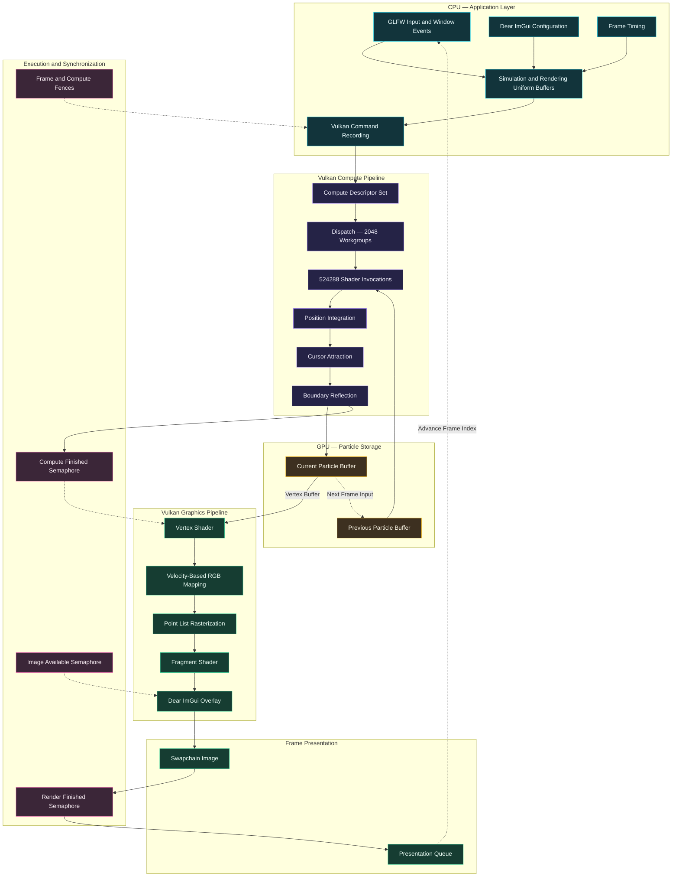

<div align="center">

  <h1>Compute Shader Lab</h1>

  <p>
    <strong>Thousands of threads, a single evolving system.</strong>
  </p>

  <p>
    A GPU-accelerated particle simulation exploring parallel computing,
    compute shaders, explicit graphics architecture, and real-time
    visualization through C++ and Vulkan.
  </p>

  [](https://isocpp.org/)
  [](https://www.vulkan.org/)
  [](#shader-architecture)
  [](#particle-simulation)
  [](#interactive-controls)

  <p>
    <a href="#overview">Overview</a> ·
    <a href="#particle-simulation">Simulation</a> ·
    <a href="#gpu-architecture">Architecture</a> ·
    <a href="#shader-architecture">Shaders</a> ·
    <a href="#interactive-controls">Controls</a> ·
    <a href="#getting-started">Getting Started</a>
  </p>

  

  <br />

  <sub>
    Parallel computing · GPU particle dynamics · Explicit graphics programming
    <br />
    Original implementation demonstration.
  </sub>

</div>

## Overview

Compute Shader Lab is a computational graphics project exploring
the execution of large particle systems through GPU compute shaders
and explicit resource management with Vulkan.

Rather than updating particle positions and velocities sequentially
on the CPU, the simulation distributes its computational workload
across hundreds of thousands of GPU shader invocations.

Particle state remains in device-local memory throughout the
simulation and rendering lifecycle. The graphics pipeline consumes
the results of the compute pipeline directly, avoiding recurring
particle-data transfers between the CPU and GPU.

The application combines numerical particle motion, interactive
external forces, boundary collisions, velocity-based coloring,
and real-time rendering within a shared Vulkan architecture.

The project explores several fundamental areas of GPU programming:

- General-purpose GPU computing (GPGPU).
- Massively parallel particle simulation.
- Explicit graphics and compute pipelines.
- GPU memory allocation and resource management.
- Descriptor sets and shader resource bindings.
- Command buffers and queue synchronization.
- Interactive computer graphics.

## Features

| Feature | Description |
| :--- | :--- |
| **GPU Particle Simulation** | Parallel updates of 524,288 particles through compute shaders. |
| **Vulkan Compute Pipeline** | Dedicated GPU pipeline for numerical particle operations. |
| **Device-Local Storage** | Particle state maintained in GPU-accessible memory. |
| **Double Buffering** | Separate input and output particle buffers exchanged between frames. |
| **Direct GPU Rendering** | Compute storage buffers reused as graphics vertex buffers. |
| **Interactive Attraction** | Directional particle acceleration toward the mouse cursor. |
| **Boundary Collisions** | Particle reflection and configurable velocity attenuation at domain boundaries. |
| **Velocity-Based Coloring** | Dynamic RGB mapping according to particle speed. |
| **Adjustable Particle Size** | Configurable graphical representation of individual particles. |
| **Explicit Synchronization** | Vulkan semaphores and fences coordinating submitted GPU workloads. |
| **Interactive Configuration** | Runtime simulation controls through Dear ImGui. |
| **SPIR-V Shaders** | Precompiled compute, vertex, and fragment shader modules. |

## Particle Simulation

The simulation represents a two-dimensional environment
containing independent particles moving through a bounded
computational domain.

Each particle carries two fundamental numerical quantities:

$$
\mathbf{x}_i=
\begin{bmatrix}
x_i\\
y_i
\end{bmatrix}
$$

$$
\mathbf{v}_i=
\begin{bmatrix}
v_{x,i}\\
v_{y,i}
\end{bmatrix}
$$

Where $\mathbf{x}_i$ represents particle position and
$\mathbf{v}_i$ represents particle velocity.

### Simulation Configuration

| Property | Configuration |
| :--- | :--- |
| Spatial dimensions | 2 |
| Particle count | 524,288 |
| Initial window resolution | 800 × 600 |
| Simulation domain | [-1, 1] × [-1, 1] |
| Numerical precision | Float32 |
| Particle attributes | Position and velocity |
| Initial particle speed | 0.00025 |
| Compute workgroup size | 256 × 1 × 1 |
| Dispatched workgroups | 2,048 |
| Particle storage buffers | 2 |
| Frames in flight | 2 |
| Rendering topology | Point List |

Particles are initially distributed randomly throughout
the simulation domain with randomized velocity directions.

The particle count is defined as a compile-time constant
in [`main.cpp`](./ComputeShader/main.cpp).

### Numerical Integration

Particle positions are advanced using their current velocity
and the simulation time step:

$$
\mathbf{x}_i^{n+1}
=
\mathbf{x}_i^n
+
\Delta t\,\mathbf{v}_i^n
$$

The implementation follows an explicit position integration
approach.

The numerical time step is derived from the measured
application frame duration and scaled internally.

Simulation time is therefore coupled to frame timing rather
than a fixed-step physical integration schedule.

### Cursor Interaction

An optional attraction mechanism introduces directional
velocity changes toward the current mouse position.

The normalized direction from a particle to the cursor is:

$$
\mathbf{d}_i=
\frac{
\mathbf{x}_{cursor}-\mathbf{x}_i
}{
\|\mathbf{x}_{cursor}-\mathbf{x}_i\|
}
$$

The corresponding velocity update is:

$$
\mathbf{v}_i^{n+1}
=
\mathbf{v}_i^n+k\mathbf{d}_i
$$

Where $k$ represents the configurable cursor attraction
strength.

The current implementation applies this velocity increment
per simulation update rather than scaling it by the
integration time step.

This interaction produces collective particle motion
without requiring direct particle-to-particle forces.

### Boundary Collisions

Particles are constrained to a normalized two-dimensional
simulation domain.

When a particle crosses a domain boundary, its position
is moved slightly inside the permitted region and the
corresponding velocity component is reflected.

The normal velocity response is:

$$
v_n^{new}=-e\,v_n^{old}
$$

Where $e$ represents the configurable boundary reflection
coefficient.

| Coefficient | Boundary Response |
| :---: | :--- |
| `0.0` | Removes the normal velocity component. |
| `0.5` | Retains half of the normal speed after reflection. |
| `1.0` | Reflects the normal velocity without reducing its magnitude. |

The interface identifies this parameter as collision energy
conservation. Numerically, it scales velocity rather than
kinetic energy directly.

The retained fraction of normal kinetic energy is:

$$
\frac{E_{new}}{E_{old}}=e^2
$$

### Computational Complexity

Each particle is updated independently using its own
previous state and shared simulation parameters.

For $N$ particles, the total numerical workload scales as:

$$
O(N)
$$

The absence of particle-to-particle interactions eliminates
the need for neighborhood search, spatial indexing, or
quadratic pairwise collision evaluation.

This makes the simulation particularly suitable for
data-parallel GPU execution.

The project is a particle dynamics experiment rather than
a continuum fluid solver or a complete particle physics engine.

## GPU Architecture

The application separates computational and graphical
operations into dedicated Vulkan pipelines.

The compute pipeline updates particle state, while the
graphics pipeline transforms that state into visible
point primitives.

Both pipelines operate on shared GPU resources.



The diagram represents the intended relationship between
resource storage, compute execution, graphics rendering,
and frame presentation.

The current implementation obtains its graphics and compute
queue handles from the same Vulkan queue family and queue index.

Separate pipelines and command buffers therefore do not
imply independent asynchronous hardware queue execution.

### CPU Responsibilities

The CPU coordinates application execution without performing
the per-particle numerical workload.

| Responsibility | Description |
| :--- | :--- |
| Device Initialization | Select a compatible physical device and create a logical device. |
| Resource Allocation | Allocate GPU buffers, descriptor pools, and uniform storage. |
| Pipeline Creation | Configure compute and graphics pipelines. |
| Input Processing | Collect cursor interaction and window events. |
| Uniform Updates | Transfer simulation and visualization parameters. |
| Command Recording | Record compute and graphics command buffers. |
| Synchronization | Coordinate GPU submission and frame presentation. |
| Resource Cleanup | Release Vulkan objects and allocated resources. |

### GPU Responsibilities

| Responsibility | Description |
| :--- | :--- |
| Numerical Integration | Advance particle positions. |
| Velocity Modification | Apply attraction and boundary responses. |
| Particle Storage | Maintain current and previous simulation states. |
| Vertex Processing | Transform particle attributes into point primitives. |
| Color Mapping | Encode particle speed into RGB values. |
| Fragment Processing | Determine circular particle coverage. |
| Rasterization | Produce graphical output. |


## GPU Memory Management

The particle representation consists of four
32-bit floating-point components.

| Attribute | Components | Nominal Size |
| :--- | :---: | ---: |
| Position | 2 × Float32 | 8 bytes |
| Velocity | 2 × Float32 | 8 bytes |
| Total per particle | 4 × Float32 | 16 bytes |

The nominal payload of one complete particle buffer is:

$$
524288\times16
=
8388608\text{ bytes}
$$

| Resource | Nominal Payload |
| :--- | ---: |
| Single particle | 16 bytes |
| Single particle buffer | 8 MiB |
| Two particle buffers | 16 MiB |
| Initial staging buffer | 8 MiB |

These figures describe raw particle payload sizes.

Actual memory consumption also includes Vulkan allocation
requirements, swapchain images, uniforms, command buffers,
graphics pipelines, and interface resources.

## Getting Started

### Requirements

- Windows development environment.
- Visual Studio 2019 or a compatible newer version.
- C++17 compiler support.
- Vulkan SDK.
- Vulkan-compatible GPU and graphics driver.
- GLFW.
- GLM.
- Git.

Dear ImGui and its Vulkan and GLFW backends are included
directly in the repository.

The original Visual Studio project uses the `v142`
platform toolset and references Vulkan SDK 1.3.250.0.

Newer development environments may require project
retargeting and dependency-path adjustments.

### Clone the Repository

```bash
git clone https://github.com/4beru/computer-shader-lab.git

cd computer-shader-lab
```

### Configure Visual Studio

Open the solution:

```text
ComputeShader.sln
```

Select the `Release` and `x64` configuration.

Open the project properties and configure the
dependency paths according to your local installation.

#### C/C++ — Additional Include Directories

```text
$(VULKAN_SDK)\Include
<GLFW_ROOT>\include
<GLM_ROOT>
```

Replace the GLFW and GLM placeholders with the actual
directories on your system.

#### Linker — Additional Library Directories

```text
$(VULKAN_SDK)\Lib
<GLFW_LIBRARY_DIRECTORY>
```

Use the GLFW library directory compatible with your
compiler toolset and selected architecture.

#### Linker — Additional Dependencies

```text
vulkan-1.lib
glfw3.lib
```

> [!IMPORTANT]
> The existing Visual Studio project contains absolute
> dependency paths from its original development environment.
>
> Replace these paths before attempting to build the application.

### Build the Application

From Visual Studio, select:

```text
Build → Build Solution
```

Alternatively, from a configured Visual Studio
Developer Command Prompt:

```bash
msbuild ComputeShader.sln /p:Configuration=Release /p:Platform=x64
```

### Run the Application

Start the application through Visual Studio.

The application loads its compiled shader modules using
relative paths:

```text
shaders/comp.spv
shaders/vert.spv
shaders/frag.spv
```

Configure the application's working directory to point
to the `ComputeShader/` directory, or make the shader
directory available relative to the executable's
working directory.

### Debug Configuration

Debug builds request the following Vulkan layers:

```text
VK_LAYER_KHRONOS_validation
VK_LAYER_LUNARG_monitor
```

Ensure that the requested layers are installed and
available.

The optional monitor layer may require adjustment
depending on the installed Vulkan SDK.

## Shader Compilation

The repository includes precompiled SPIR-V shader
modules, so recompilation is not required when using
the existing shader resources.

After modifying GLSL source files, regenerate their
corresponding SPIR-V modules using `glslc`.

From the repository root:

```bash
cd ComputeShader/shaders
```

Compile the compute shader:

```bash
glslc shader_compute.comp -o comp.spv
```

Compile the vertex shader:

```bash
glslc shader.vert -o vert.spv
```

Compile the fragment shader:

```bash
glslc shader.frag -o frag.spv
```

Ensure that the Vulkan SDK binary directory is
available in your system PATH.

### Portable Shader Compilation Script

The existing `compile.bat` references an absolute
Vulkan SDK installation path.

A portable replacement can use the `VULKAN_SDK`
environment variable:

```bat
@echo off
setlocal

cd /d "%~dp0"

if not defined VULKAN_SDK (
    echo VULKAN_SDK is not configured.
    exit /b 1
)

set "GLSLC=%VULKAN_SDK%\Bin\glslc.exe"

"%GLSLC%" shader_compute.comp -o comp.spv || exit /b 1
"%GLSLC%" shader.vert -o vert.spv || exit /b 1
"%GLSLC%" shader.frag -o frag.spv || exit /b 1

echo Shader compilation completed successfully.
```

This is a suggested portability improvement rather
than the current contents of the repository.

---

<div align="center">

  <h3>Parallel by design, dynamic by nature.</h3>

  <p>
    Part of <strong>Computational Simulation</strong> — a collection
    of projects exploring numerical methods, mathematical modeling,
    physical phenomena, and the computational representation
    of dynamic systems.
  </p>

  <p>
    <sub>Curated by Abel Ortega.</sub>
  </p>

  <a href="https://github.com/4beru">GitHub</a> ·
  <a href="https://www.aberu.site">Portfolio</a>

</div>
